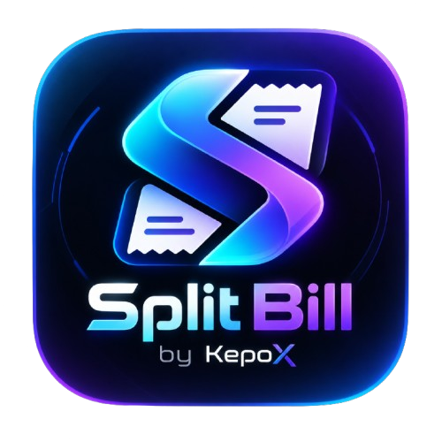

<div align="center">
  

  <h1>Split Bill By KepoX</h1>
  <p>Aplikasi mobile local-first untuk memindai struk, membagi tagihan, dan mengelola riwayat patungan.</p>

  <p>
    
    
    
    
  </p>
</div>

## Tentang aplikasi

**Split Bill By KepoX** membantu kelompok menghitung pembagian tagihan tanpa mengirim foto struk atau data tagihan ke layanan OCR berbasis cloud. OCR berjalan di perangkat menggunakan Google ML Kit, sedangkan riwayat dan pengaturan disimpan secara lokal.

Aplikasi masih dalam tahap pengembangan. Hasil OCR dan parsing perlu diperiksa sebelum tagihan disimpan atau dibagikan.

> Untuk kontributor & agent: baca [`docs/PROJECT_NOTES.md`](docs/PROJECT_NOTES.md) — panduan OTA vs build ulang, arsitektur, konvensi, dan pelajaran proyek.

## Fitur

- Memindai struk dengan kamera atau memilih foto dari galeri.
- Mengenali teks struk secara lokal dengan Google ML Kit Text Recognition.
- Menyusun teks OCR berdasarkan tata letak baris dan mendeteksi kandidat item serta harga — kuat untuk format kafe (Faste, StopOne) dan retail (Indomaret, Alfamart).
- Memeriksa dan mengedit item hasil OCR secara manual.
- Menambahkan anggota, lalu membagi item kepada satu atau beberapa orang; item tanpa pemilik dibagi ke semua anggota.
- Membagi pajak, biaya layanan, dan diskon secara proporsional, dengan pembulatan *largest-remainder* agar total semua orang persis sama dengan grand total.
- Menyimpan riwayat tagihan (nama bisa diedit), status pembayaran, kategori, metode pembayaran, dan data koreksi OCR di penyimpanan lokal.
- Membagikan ringkasan tagihan dan detail pembayaran; gambar QRIS dapat disertakan jika tersedia.
- Ekspor/impor backup data (.json) dari halaman Pengaturan.
- Pembaruan aplikasi over-the-air (EAS Update): banner pembaruan di Beranda + mode otomatis/manual di Pengaturan, dengan changelog in-app.

## Teknologi

- React Native 0.86 dan Expo SDK 57
- TypeScript (strict)
- Google ML Kit melalui `@react-native-ml-kit/text-recognition`
- AsyncStorage untuk penyimpanan lokal, Zustand untuk state management
- React Navigation (native stack)
- expo-image, expo-camera, expo-image-picker, expo-clipboard, expo-updates, react-native-share
- Design tokens terpusat di `src/theme.ts`; formatter Intl di-cache di `src/utils/format.ts`

## Alur penggunaan

1. Pilih **Pindai Struk Baru**, lalu gunakan kamera atau galeri.
2. Periksa dan koreksi item serta harga yang dikenali.
3. Tambahkan anggota, tetapkan item, lalu masukkan pajak, biaya layanan, atau diskon.
4. Tinjau total tiap orang dan simpan tagihan ke riwayat.
5. Bagikan ringkasan tagihan atau salin teksnya.

## Struktur proyek

```text
.
├── assets/                 # Logo dan aset aplikasi
├── src/
│   ├── components/         # Komponen UI bersama
│   ├── hooks/              # Hook aplikasi
│   ├── navigation/         # Konfigurasi navigasi
│   ├── screens/            # Layar aplikasi
│   ├── store/              # State dan penyimpanan lokal
│   ├── types/              # Tipe TypeScript
│   └── utils/              # OCR, parsing, dan perhitungan split
├── App.js
├── app.json
└── eas.json
```

## Menjalankan untuk pengembangan

### Persyaratan

- Node.js versi LTS dan npm
- Android Studio, Android SDK, dan perangkat/emulator Android untuk menjalankan Android
- Xcode untuk menjalankan iOS di macOS
- Custom development build untuk modul native seperti ML Kit

### Instalasi

```bash
npm install
```

Jalankan development server:

```bash
npx expo start --dev-client
```

Untuk menjalankan langsung di Android dengan Android SDK yang sudah dikonfigurasi:

```bash
npm run android
```

Verifikasi kualitas (sama dengan yang dijalankan CI):

```bash
npm test          # 91+ test: parser OCR, parser struk asli, dan pembagian tagihan
npx tsc --noEmit  # typecheck
npx expo lint     # lint (0 masalah dipertahankan)
```

> **Catatan:** Google ML Kit menggunakan modul native sehingga aplikasi ini tidak dapat menjalankan fitur OCR di Expo Go standar. Gunakan custom development client atau native build.

## Build dan rilis

Profil EAS: `preview` (APK, channel `preview`, distribusi internal) dan `production` (APK store). Build release mengaktifkan ProGuard/R8 dan resource shrinking melalui `expo-build-properties`.

```bash
# Build APK baru (diperlukan saat modul native berubah)
npx eas-cli build --platform android --profile preview

# Update over-the-air untuk perubahan JavaScript saja (runtime harus cocok)
npx eas-cli update --branch preview --platform android --environment production --non-interactive
```

Distribusi APK dilakukan lewat GitHub Releases (tag `Beta`, di-update setiap rilis). `eas update` hanya mengirim bundle JS ke perangkat — **tidak** meng-push ke GitHub; jalankan `git push` terpisah.

> **Catatan runtime:** `runtimeVersion` memakai policy `appVersion` — pembaruan OTA hanya sampai ke build dengan versi yang sama. Jangan bump `app.json` sebelum build baru benar-benar terpasang.

## Privasi dan batasan

- Pemrosesan OCR dilakukan di perangkat. Hasil OCR, koreksi, metode pembayaran, dan riwayat tagihan disimpan menggunakan penyimpanan lokal aplikasi.
- Berbagi tagihan menggunakan menu share perangkat dan aplikasi tujuan yang dipilih pengguna. Aplikasi tujuan mungkin memerlukan koneksi internet.
- OCR dan parser menggunakan pengenalan teks serta heuristik format struk; akurasi dapat berbeda antarstruk. Selalu periksa nama item, harga, pajak, biaya layanan, dan diskon.
- Menghapus atau memasang ulang aplikasi menghapus data lokal. Gunakan **Ekspor Data** di Pengaturan untuk mencadangkan riwayat ke file, dan **Impor dari Clipboard** untuk memulihkannya. Tidak ada sinkronisasi cloud.

## Kontribusi dan pelaporan masalah

Proyek ini masih aktif dikembangkan. Untuk melaporkan masalah, sertakan:

- Langkah untuk mereproduksi masalah.
- Versi aplikasi, versi Android/iOS, dan jenis perangkat.
- Contoh teks OCR atau struk yang sudah disamarkan dari informasi pribadi.
- Pesan error atau screenshot yang relevan.

Repository: [Kepoo311/split\_bill\_project](https://github.com/Kepoo311/split_bill_project)
